# Tiba Boutique Store

Ứng dụng web quản lí **kho hàng, cho thuê trang phục biểu diễn và đặt hàng xưởng** cho cửa hàng Tiba Store, xây dựng bằng **Laravel 9**.

Hệ thống theo dõi tồn kho theo từng **mã + size**, lên đơn thuê theo lịch đi đơn / lấy / diễn / trả / về kho, dự báo tồn khả dụng theo từng ngày (có tính hàng đang đặt xưởng), quản lí đặt hàng – nhập kho, in hoá đơn, báo cáo doanh thu và ghi lại toàn bộ lịch sử thay đổi.


> Ảnh chụp màn hình trong tài liệu được chụp từ **bản production đang chạy**. Tên miền và **số điện thoại khách hàng** đã được che.

---

## Mục lục

- [Giao diện](#giao-diện)
- [Chức năng chính](#chức-năng-chính)
- [Mô hình tồn kho](#mô-hình-tồn-kho)
- [Công nghệ](#công-nghệ)
- [Cài đặt](#cài-đặt)
- [Chạy ứng dụng](#chạy-ứng-dụng)
- [Kiểm thử](#kiểm-thử)
- [Triển khai (cPanel)](#triển-khai-shared-hosting--cpanel)
- [Cấu trúc thư mục](#cấu-trúc-thư-mục)

---

## Giao diện

### Kho hàng
Sản phẩm nhóm theo **danh mục**, mỗi mã gồm nhiều size. Mỗi mã có ảnh, giá thuê, số lượng sẵn sàng / đang thuê, lịch hàng dự kiến về. Có hoàn tác / làm lại và nút nhắc nhập kho.

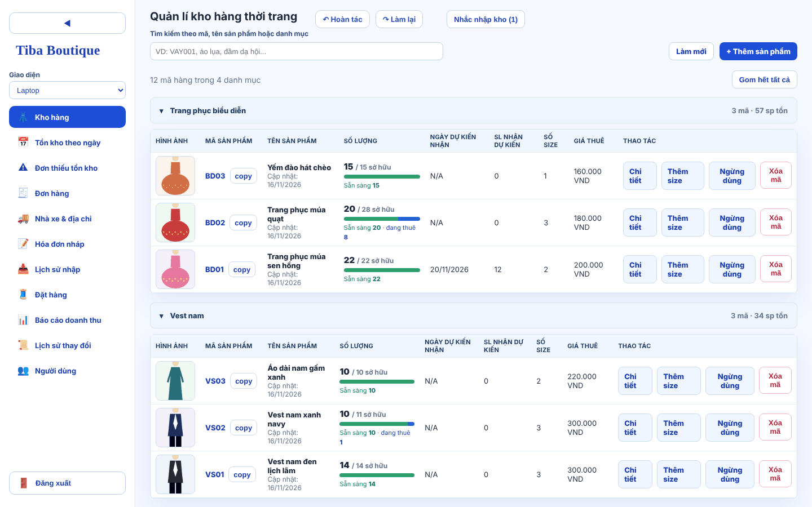

### Chi tiết sản phẩm
Sửa trực tiếp tên, danh mục, giá thuê, ảnh (dán bằng Ctrl+V) và số lượng từng size, thay đổi **tự lưu**. Hiển thị tổng số hàng, đang cho thuê, còn trong kho và lịch dự kiến hàng về từ đặt xưởng.

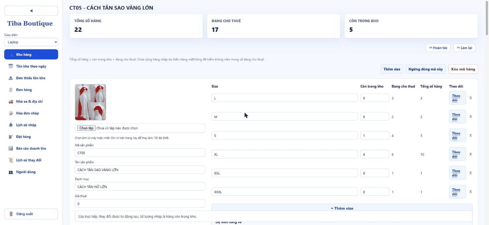

### Tồn kho theo ngày
Ma trận số lượng **khả dụng** của từng mã–size theo mỗi ngày, lọc theo danh mục. Ô xanh còn nhiều, vàng còn ít, đỏ hết/vượt; cột hôm nay viền xanh dương.

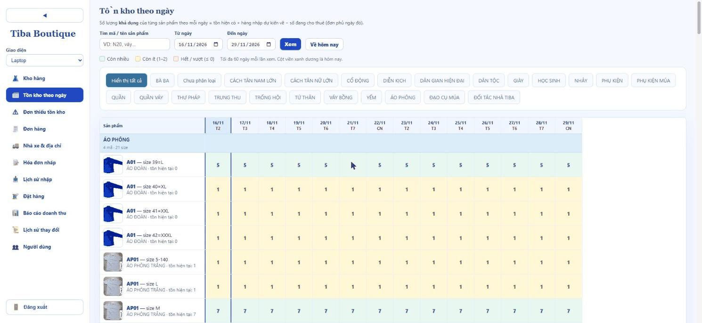

### Đơn hàng
Danh sách đơn kèm người chốt, ngày đi đơn / lấy / diễn / trả / về kho thực tế, trạng thái tô màu, tổng đơn, tổng còn lại. Mở rộng từng đơn để xem **dạng hoá đơn** nhóm theo mã, có ảnh, trạng thái giao từng mã và bảng thanh toán. Đơn thiếu hàng được đánh dấu đỏ ở cột người chốt.

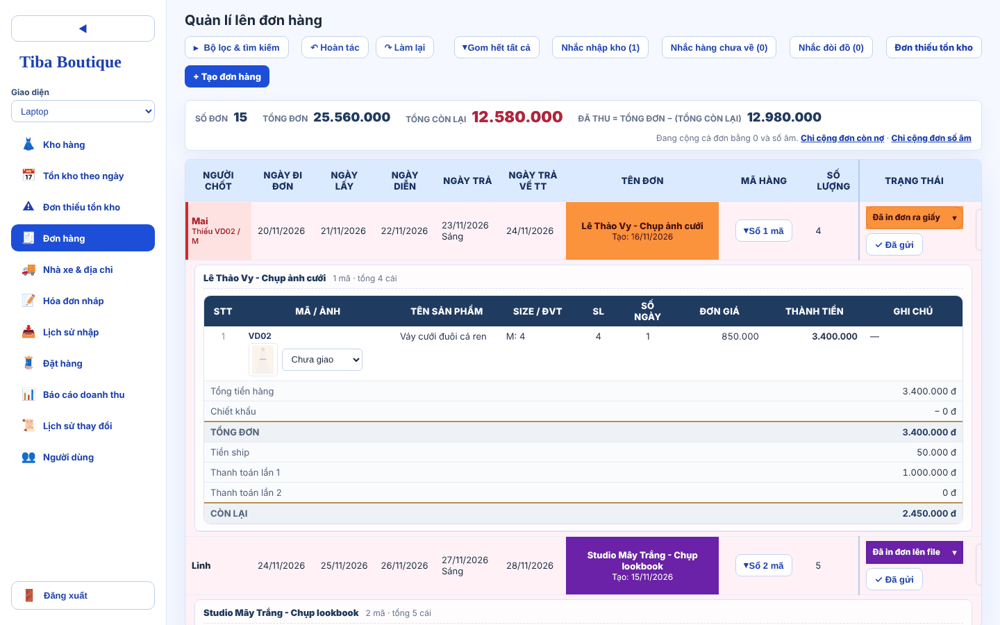

### Tạo / sửa đơn
Form chia khối: thông tin khách (có **dán phiếu đặt thuê** để tự điền, gợi ý khách cũ), lịch thuê & xử lý, sản phẩm & thanh toán. Form **tự lưu nháp**, có hoàn tác / làm lại.

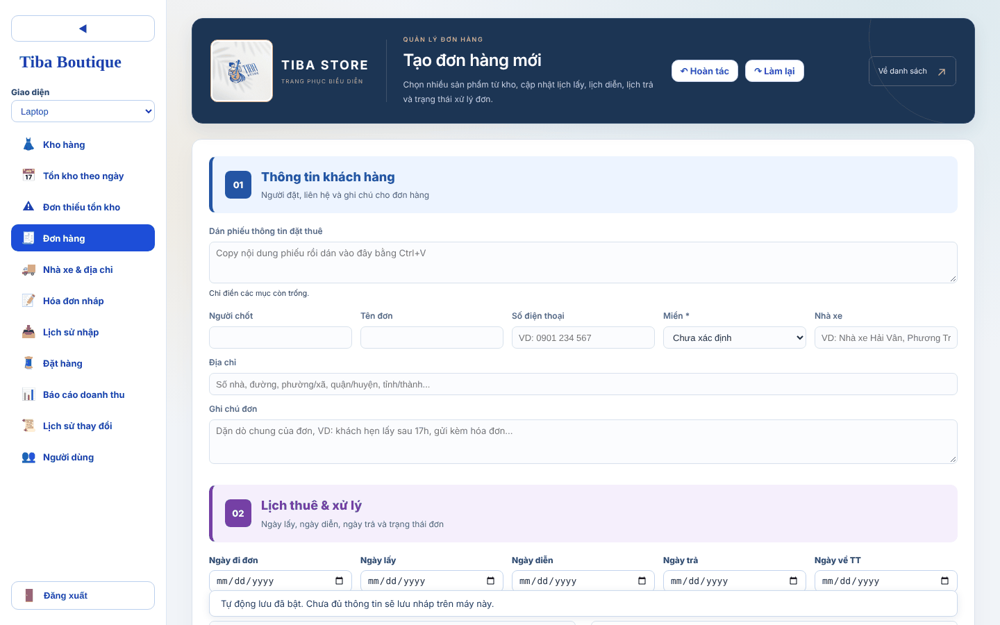

### Chi tiết đơn
Trang thông tin đơn mang thương hiệu Tiba Store, đổi trạng thái nhanh và in / chụp đơn.

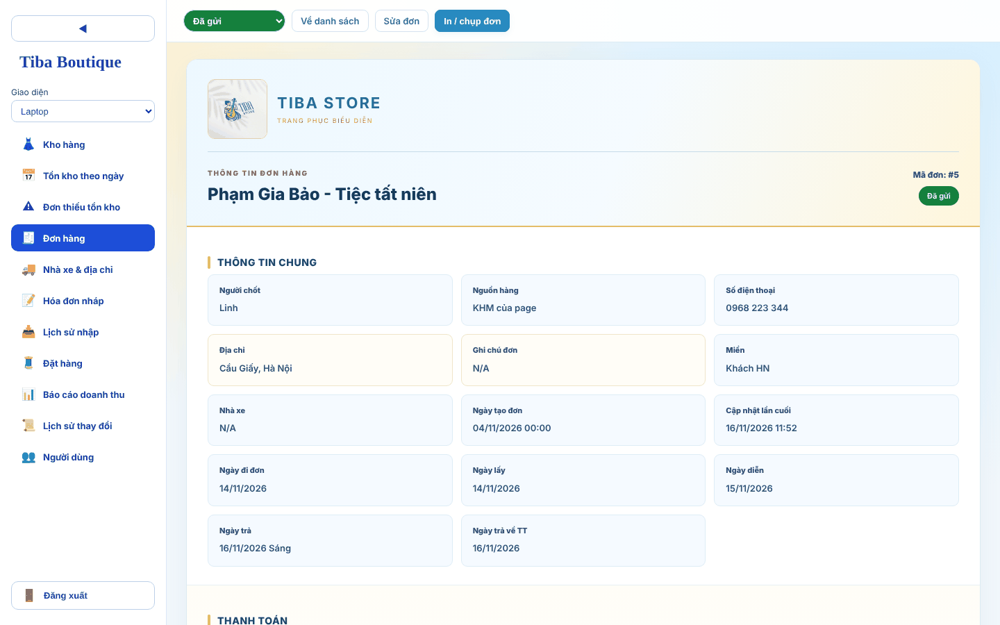

### Đơn thiếu tồn kho
Rà soát các đơn đã lưu đang thiếu hàng thực tế theo mã, size và lịch thuê; liên kết thẳng tới đơn để xử lý.

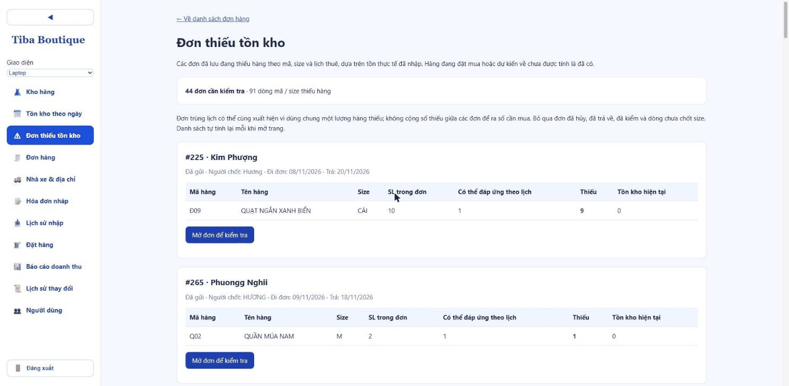

### Đặt hàng (xưởng / mua ngoài)
Bảng sửa trực tiếp, tự lưu: mã (hoặc **tạo mã mới** ngay tại đây), ảnh, size – số lượng, đơn giá, đơn khách liên kết, nhà cung cấp, trạng thái `Chưa od` / `Đã od` / `Hàng đã về`. Lọc theo trạng thái, cách nhập kho, nhà cung cấp, người mua, khoảng ngày.

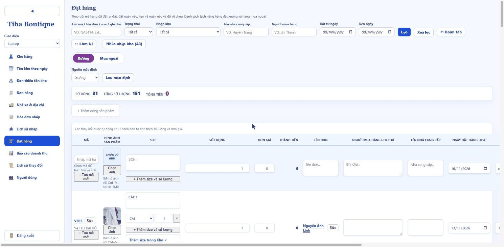

### Hoá đơn nháp
Phiếu bán hàng sửa trực tiếp, chọn sản phẩm bằng ảnh, chiết khấu theo số tiền hoặc %, số ngày thuê lẻ; in / lưu PDF khổ A4.

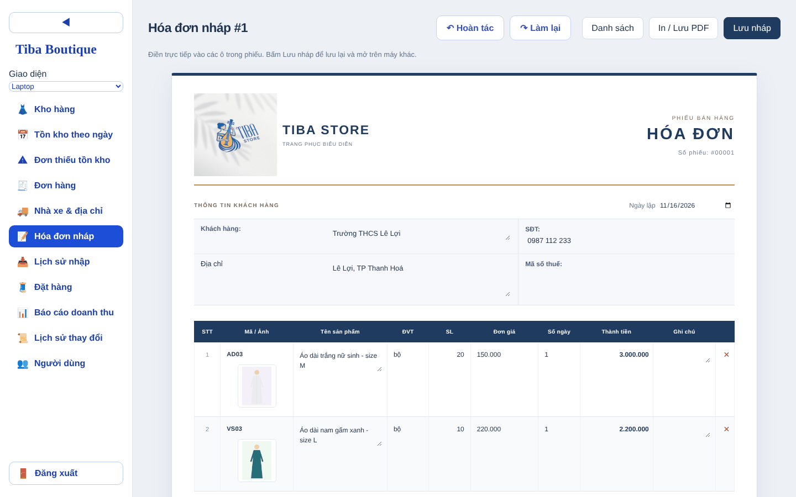

### Nhà xe & địa chỉ
Danh bạ nhà xe và địa chỉ được gom tự động từ đơn hàng, nhóm theo tỉnh/thành, tìm kiếm không dấu.

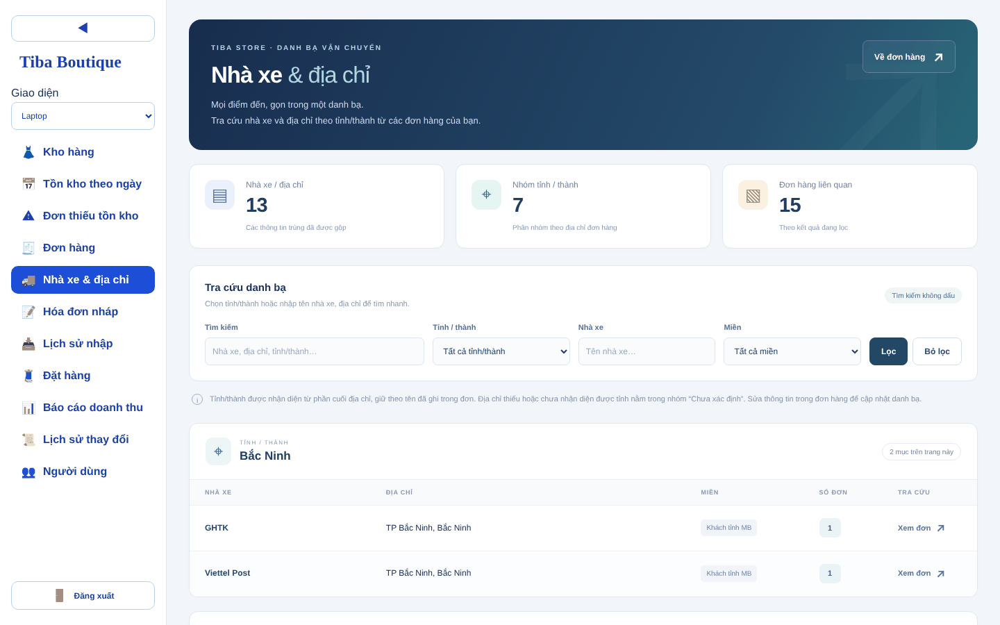

### Báo cáo doanh thu
Tổng doanh thu, tiền bồi thường, số đơn; tách theo nguồn khách (KHM/KHC của page/sale) kèm tỷ trọng. Mặc định tháng hiện tại, chọn được nhiều mốc ngày.

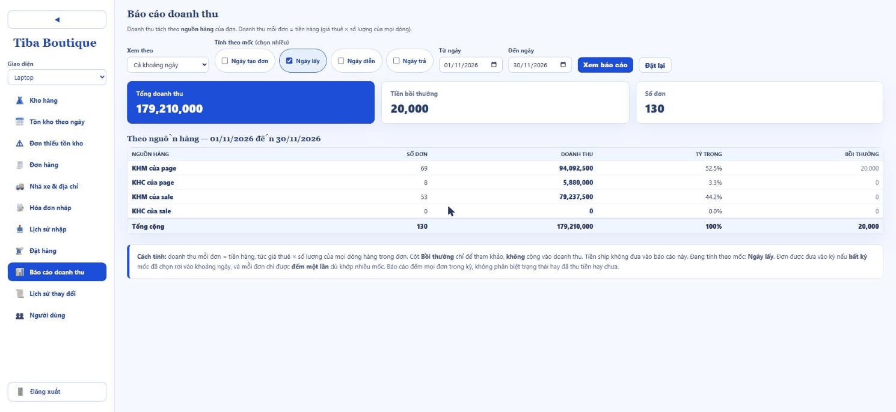

### Lịch sử thay đổi
Nhật ký mọi thay đổi của đơn hàng và sản phẩm dạng *trước → sau*, ai làm, lúc nào; lọc theo loại, hành động, mã, người thực hiện, khoảng ngày.

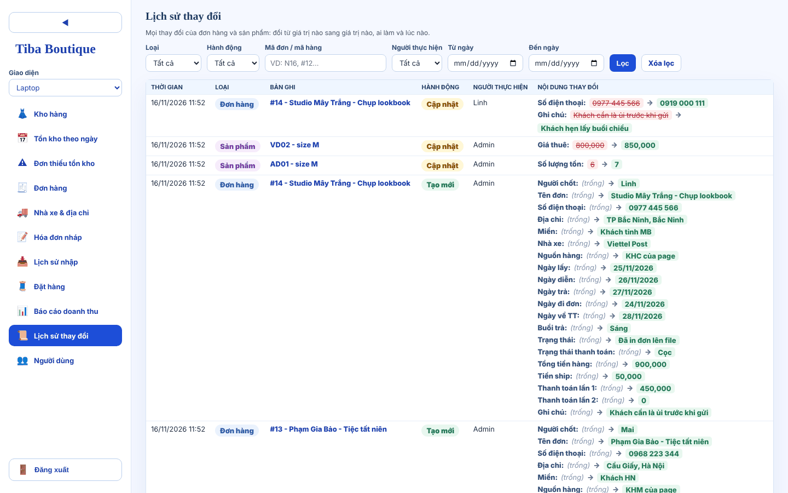

### Giao diện điện thoại và nhắc việc
Chọn chế độ **Laptop / Máy tính cây / Điện thoại** ở sidebar (màn hình nhỏ tự chuyển sang điện thoại). Khi mở trang, hệ thống hiện các nhắc việc như xác nhận hàng về để nhập kho lần lượt.

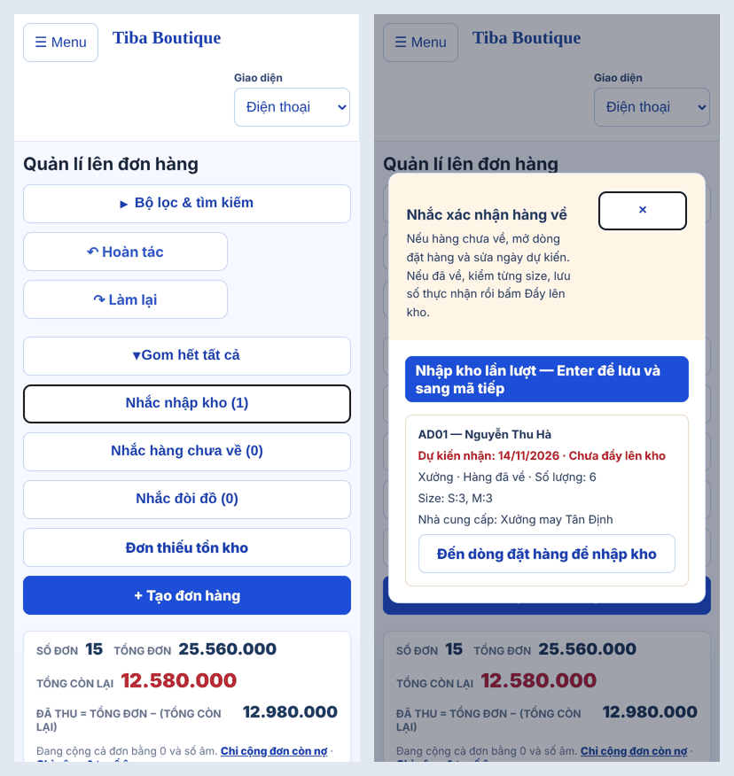

---

## Chức năng chính

### Kho hàng & sản phẩm
- Mỗi dòng kho là một cặp **mã + size** (không trùng); thông tin chung theo mã: tên, ảnh, danh mục, giá thuê (cho phép giá dạng chữ).
- Sửa size, số lượng ngay trên trang, xoá từng size có xác nhận; thêm/sửa ảnh bằng tải lên hoặc dán.
- Ngừng dùng / xoá mã; tìm theo mã, tên, danh mục (kể cả mã đã hết hàng).
- **Lịch sử nhập kho**: ghi nhận nhập trực tiếp, tăng/giảm tồn và nhập từ đặt xưởng; có hoàn tác lần nhập.
- Theo dõi một mã–size: các đơn liên quan và biến động tồn dự kiến.

### Đơn hàng
- Thông tin khách: người chốt, tên đơn, SĐT, địa chỉ, **miền** (bắt buộc), nhà xe, **nguồn khách** (bắt buộc), ghi chú.
- Lịch: **ngày đi đơn**, ngày lấy, ngày diễn, ngày trả (kèm buổi sáng/chiều/tối, mặc định sáng), **ngày về kho thực tế**.
- Nhiều dòng hàng; cùng một mã có thể có nhiều giá thuê, số ngày thuê lẻ, ghi chú từng size, size "Chưa chốt".
- **Nguồn hàng từng mã**: lấy từ kho hoặc từ đặt hàng; liên kết với đơn đặt xưởng phù hợp, đặt thêm lô bổ sung, dùng một phần lô mua dự trữ.
- Tiền: tổng tiền hàng, chiết khấu (tiền hoặc %), tiền ship, thanh toán lần 1 / lần 2, tiền bồi thường, còn lại. Định dạng tiền kiểu Việt Nam.
- **Tự lưu** form (chống tạo đơn trùng), **hoàn tác / làm lại** cá nhân, dán phiếu đặt thuê để điền nhanh, gợi ý khách cũ.
- Sửa ghi chú ngay trên danh sách; bấm để sao chép tên đơn, mã hàng.
- Theo dõi từng mã trong đơn: **đã chuẩn bị**, **đã giao** (cho phép giao sớm theo mã).
- Lọc theo trạng thái, nguồn, người chốt, mã hàng, khoảng ngày đi đơn / về kho; lọc theo mã chỉ hiện các dòng khớp.

### Trạng thái đơn
`Chưa in đơn` → `Đã in đơn lên file` → `Đã in đơn ra giấy` → `Đang soạn đơn` → `Đã soạn xong` → `Đã gửi` → `Đã trả về` → `Đã kiểm` (hoặc `Hủy đơn`).

- Khi chuyển sang `Đã gửi`, hệ thống kiểm tồn thực tế; nếu thiếu sẽ báo rõ mã, size và liên kết tới đúng dòng kho.
- Khi `Đã kiểm`, nếu số lượng trả về không khớp thì bôi đỏ và cho nhập tiền bồi thường + ghi chú kiểm đơn.
- Trạng thái thanh toán: `Cọc`, `Thanh toán lần 1`, `Thanh toán lần 2`, `Còn lại`.

### Đặt hàng & nhập kho
- Hai nguồn: **Xưởng** và **Mua ngoài**, lưu nguồn mặc định.
- Bảng sửa trực tiếp, tự lưu, **hoàn tác / làm lại 5 bước** cho từng người; cảnh báo đặt trùng.
- Tạo mã sản phẩm mới ngay từ dòng đặt hàng (gợi ý mã chưa dùng, chọn danh mục, giá thuê, ảnh).
- Kế hoạch mua thêm theo đơn khách được áp **một lần rồi khoá**, không cộng dồn khi sửa.
- Nhập kho theo size từ dòng đặt hàng (**đẩy lên kho**) hoặc **xác nhận nhập tay**; nhập kho lần lượt bằng Enter; sửa số lượng thực nhận và cập nhật sang đơn khách.

### Nhắc việc
- **Nhắc nhập kho** khi hàng đặt đã về; **nhắc hàng chưa về** theo ngày dự kiến.
- **Nhắc đòi đồ** khi đơn mới lấy trùng ngày trả của đơn trước.
- Nhắc theo ngày lấy / ngày trả; đánh dấu các đơn bị ảnh hưởng khi tồn kho thay đổi.
- Mỗi nhắc việc có thể xác nhận, **Không nhắc lại** hoặc **Để sau**.

### Hoá đơn nháp, danh bạ, báo cáo, nhật ký
- **Hoá đơn nháp**: lưu, sửa, in A4 với logo Tiba Store.
- **Nhà xe & địa chỉ**: danh bạ nhóm theo tỉnh/thành.
- **Báo cáo doanh thu** theo nguồn khách và mốc ngày.
- **Lịch sử thay đổi** chi tiết cho đơn hàng và sản phẩm.

### Người dùng
- Đăng nhập bằng mã đăng nhập + mật khẩu.
- Phân quyền **admin** / **cộng tác viên**; quản lí người dùng dành cho admin.

---

## Mô hình tồn kho

- Tồn được tính theo **ngày đi đơn** và **ngày về kho thực tế** (đơn cũ thiếu hai ngày này được điền từ ngày lấy / ngày trả), vẫn giữ quy tắc gối đơn: được nhận đơn lấy trong ngày nếu hàng trả về buổi sáng.
- Đơn chưa gửi: **chưa trừ kho**. Khi `Đã gửi`: **trừ tồn** theo số lượng đơn (thiếu thì báo lỗi, không cho chuyển). Khi `Đã kiểm`: **hoàn** về kho. Gia hạn đơn đã gửi vẫn giữ phần hàng đang ở ngoài.
- Sửa mã/số lượng của đơn đang trừ kho sẽ tự đồng bộ theo phần chênh lệch.
- Tồn **khả dụng** (dùng cho cảnh báo và trang Tồn kho theo ngày) = tồn hiện có + hàng sắp về từ đặt hàng − số đang cho thuê trong các khoảng thuê chồng nhau.
- Trang **Đơn thiếu tồn kho** chỉ tính tồn thực tế đã nhập, không tính hàng đang đặt.

---

## Công nghệ

- **Laravel 9** (PHP `^8.0.2`), Blade, Eloquent.
- **MySQL / MariaDB** (một số migration dùng cú pháp riêng của MySQL).
- Giao diện Blade + CSS + JavaScript thuần, **không cần build front-end**.
- Test: PHPUnit (PHP) và Node.js (`tests/js/*.cjs`).

---

## Cài đặt

Yêu cầu: PHP `^8.0.2` (có `pdo_mysql`, `gd`, `mbstring`), Composer, MySQL hoặc MariaDB, Git. Trên Windows khuyến nghị **XAMPP**.

```bash
git clone https://github.com/nminhcuongdev/tibastore.git
cd tibastore
composer install
cp .env.example .env          # Windows PowerShell: Copy-Item .env.example .env
php artisan key:generate
```

> Nếu `php` chưa có trong PATH khi dùng XAMPP, thay `php` bằng đường dẫn PHP của XAMPP, ví dụ `C:\xampp\php\php.exe`.

### Database

```sql
CREATE DATABASE tibastore CHARACTER SET utf8mb4 COLLATE utf8mb4_unicode_ci;
```

Cập nhật `.env`:

```env
DB_CONNECTION=mysql
DB_HOST=127.0.0.1
DB_PORT=3306
DB_DATABASE=tibastore
DB_USERNAME=root
DB_PASSWORD=
```

Chạy migration, seed dữ liệu mẫu (tuỳ chọn) và tạo symlink cho ảnh sản phẩm:

```bash
php artisan migrate
php artisan db:seed
php artisan storage:link
```

Tài khoản mẫu khi chạy seeder:

```text
Mã đăng nhập: admin
Mật khẩu: password
```

> Có sẵn file SQL dump thì có thể import trực tiếp vào database `tibastore` thay cho `migrate` / `db:seed`.
>
> ⚠️ Một số migration có **cập nhật dữ liệu cũ** (điền ngày đi đơn / về kho, đánh dấu cách nhập kho của đơn đặt hàng). Hãy **sao lưu database** trước khi chạy `migrate` trên dữ liệu thật.

---

## Chạy ứng dụng

```bash
php artisan serve
```

Windows với XAMPP:

```powershell
C:\xampp\php\php.exe artisan serve --host=127.0.0.1 --port=8000
```

Mở trình duyệt tại `http://127.0.0.1:8000/login`.

---

## Kiểm thử

Test PHP chạy trên database MySQL đã migrate (test **không** tự tạo bảng). Nên dùng một database riêng:

```sql
CREATE DATABASE tibastore_test CHARACTER SET utf8mb4 COLLATE utf8mb4_unicode_ci;
```

```bash
DB_DATABASE=tibastore_test php artisan migrate
DB_DATABASE=tibastore_test php artisan test
```

Test JavaScript (Node.js 18+):

```bash
for f in tests/js/*.cjs; do node "$f"; done
```

---

## Triển khai (shared hosting / cPanel)

`deploy.sh` tự kéo code và cập nhật ứng dụng, chạy định kỳ bằng **cron**:

- Chỉ chạy khi có **commit mới** (dùng file đánh dấu), tránh phình log và xoá cache không cần thiết.
- Kéo code → xoá cache config/route → `migrate --force` → `route/config/view/cache:clear`.
- Tự dò PHP CLI `>= 8.0.2` phù hợp trên hosting (ea-php / alt-php / `/usr/local/bin/php`).

Ví dụ cron mỗi 5 phút:

```bash
*/5 * * * * /home/<user>/tibastore/deploy.sh >> /home/<user>/deploy.log 2>&1
```

---

## Cấu trúc thư mục

```text
app/Http/Controllers   Controller: đơn hàng, sản phẩm, đặt hàng, hoá đơn nháp, báo cáo, nhật ký...
app/Models             Model Eloquent (Order, OrderItem, Product, WorkshopOrder, DraftInvoice...)
app/Services           Nghiệp vụ: tính tồn, kế hoạch mua, nhập kho, nhắc việc, hoàn tác...
database/migrations    Cấu trúc database
resources/views        Giao diện Blade
resources/images       Logo dùng cho hoá đơn / đơn in
public/js              Script dùng chung (định dạng tiền...)
routes/web.php         Khai báo route
tests/                 Test PHPUnit (Feature, Unit) và test JS (tests/js)
screenshoots/          Ảnh chụp màn hình dùng trong README
deploy.sh              Script tự triển khai trên cPanel
```

---

## Một số lệnh hữu ích

```bash
php artisan migrate       # chạy migration mới
php artisan db:seed       # chạy lại seed
php artisan view:clear    # xoá cache view
php artisan route:list    # xem danh sách route
```
